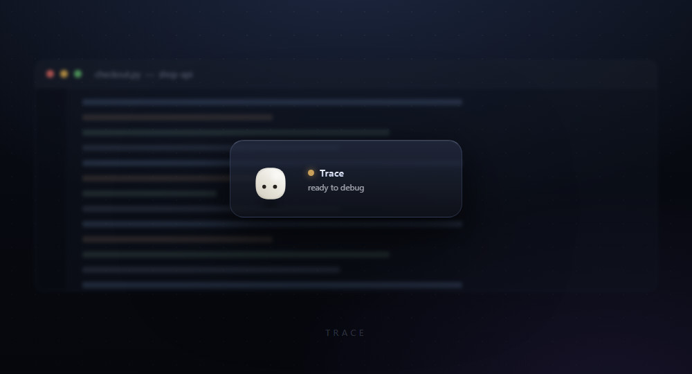
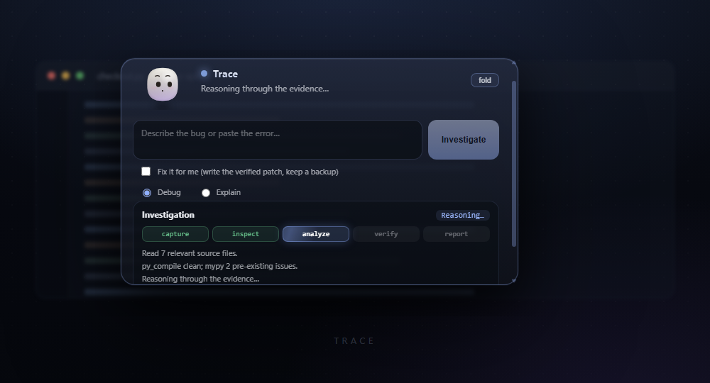
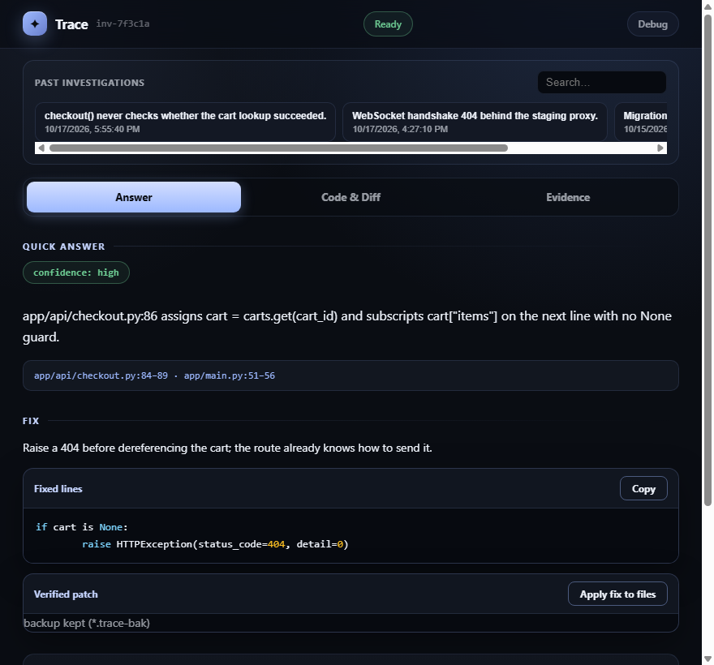
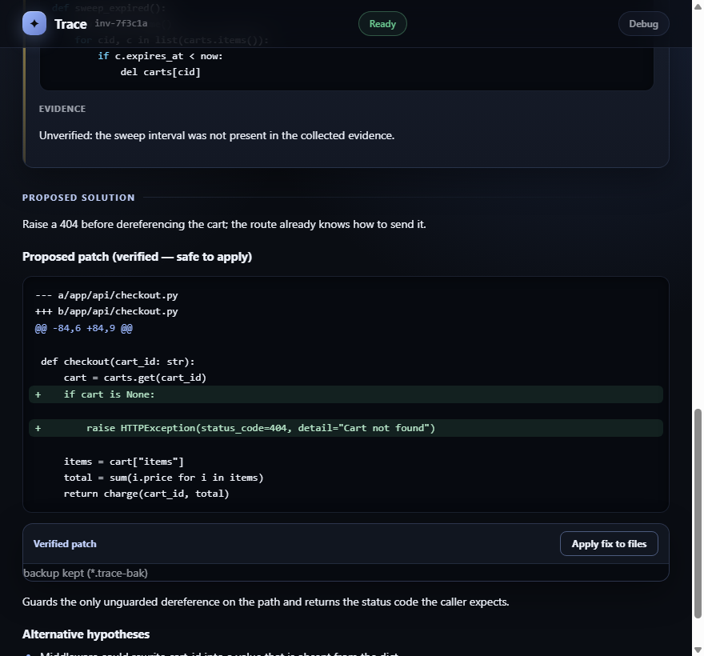
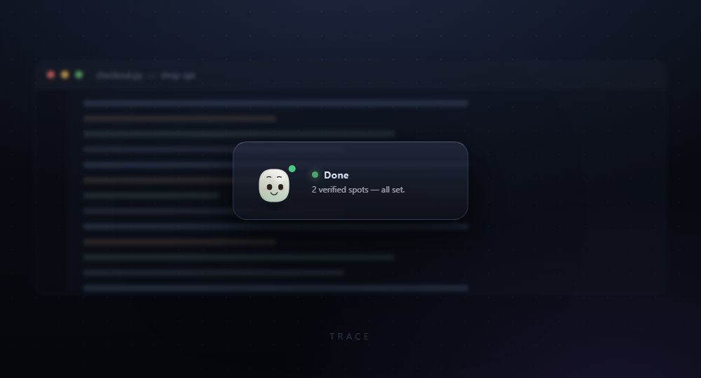

<div align="center">
  
  <h1>Trace</h1>
  <p><strong>An AI debugging companion that verifies every file it cites.</strong></p>
  <p>
    Describe the bug. Trace captures your screen, reads your actual source,
    runs your project's diagnostics, and returns a verdict — with every
    <code>file:line</code> checked against the files on disk before you see it.
  </p>
  <p>
    <a href="https://github.com/imbdy/Trace/releases/latest">
      
    </a>
    <a href="https://github.com/imbdy/Trace/releases">
      
    </a>
    <a href="https://github.com/imbdy/Trace/commits/main">
      
    </a>
    
    
  </p>
</div>

---

## Why this exists

Ask a language model about a bug and it will, with total confidence, tell you to
fix `app/handlers/user.py:142`. Sometimes that file exists. Sometimes it does not.
Either way the answer reads exactly the same, and you find out which it was only
after you have chased the reference.

Trace is built around removing that failure mode. Every location it reports is
opened on disk and checked. Anything it cannot confirm is moved out of the
findings and into a clearly labelled **unverified — treat as hypothesis, not
fact** section. There is no third bucket where a guess quietly becomes a fact.

| | A bare LLM | Trace |
|---|---|---|
| File paths | Invented, plausible | Opened and confirmed on disk |
| Line numbers | Approximate | Verified against the file |
| Your screen | Not sent | Captured and redacted |
| Your clipboard | Read if asked | **Never read** |
| Patches | Prose suggestions | Unified diff, verified, backed up |
| "I'm not sure" | Rarely survives formatting | First-class, its own section |

---

## Screenshots

<p align="center">
  
</p>

Trace lives as a small floating companion above your work. It is not in your
taskbar, not in your way, and it has nothing to say until you ask.

<p align="center">
  
</p>

Click the face to open it, describe the bug, press <kbd>Investigate</kbd>. The
progress rail lights up one step at a time — but only for stages the backend
actually reported. Nothing is simulated to make it look busy.

<p align="center">
  
</p>

<p align="center">
  
</p>

The results window is a three-tab workspace: **Answer** for the verdict,
**Code & Diff** for verified locations and the proposed patch, **Evidence** for
what was collected and what is still missing.

<p align="center">
  
</p>

<p align="center">
  <sub>Screenshots are real renders of the shipped UI, driven by a synthetic
  investigation. The <code>shop-api</code> example project is fictional.</sub>
</p>

---

## How an investigation runs

Ten stages, streamed over the loopback API as server-sent events. The UI's
five-step rail is a view onto them, not a separate progress bar:

```
receive  →  screenshot  →  context  →  project_root  →  error_extract
        →  read_files  →  diagnostics  →  model_analysis  →  validate  →  report
```

The pipeline runs as an explicit agent graph (a ~200-line, stdlib-only
runtime — same shape as LangGraph: named nodes, conditional edges, parallel
fan-out/fan-in, bounded self-repair), so structure is auditable rather than
buried in nested ifs:

- **Independent collection is parallel.** Screenshot ∥ local context,
  file reads in batches, diagnostics ∥ tests ∥ code intelligence, and
  per-finding git enrichment all run concurrently on small bounded thread
  pools — with sequential fallbacks and per-branch fault isolation. A slow
  linter can no longer stall a screenshot.
- **The model can hold more evidence.** SEARCH HITS from whole-project
  keyword scans (parallel), symbol-definition locations, per-file outlines
  and complexity notes, top-level `*.json` syntax checks, TODO/FIXME
  anchors, parsed test-failure `file:line` anchors, and — when nothing
  could be read — an honest PROJECT TREE / RECENTLY MODIFIED section for
  orientation. Everything is real disk data; the validator still gates
  anything the model cites from it.
- **Malformed model JSON gets one bounded repair.** If the verdict isn't
  valid JSON, Trace re-asks once with a JSON-only prompt. Still broken? An
  honest low-confidence report; never a fabricated one.
- **The reasoning phase is visible.** The model streams its analysis; the
  backend emits throttled "thinking ▸ …" stage events (whitespace-collapsed
  tails of the newest output, capped per call), so the once-silent
  `model_analysis` gap shows live reasoning in the character's status and
  the activity log. Parsing/verification semantics are unchanged.
- **The graph path is in the evidence.** `Evidence` shows which nodes the
  run actually visited (`receive → capture ∥ → … → report`), plus
  per-branch parallel timings, so a verdict is inspectable end-to-end.
- **`error_extract` is skipped in Explain mode**, and stack-frame files are
  not pre-loaded — you are not debugging, you are asking what something does.
- **`validate` is the important one.** It is what opens each cited path on disk.
- Follow-up questions re-run a six-stage subset against the files the previous
  report already cited (re-read in parallel), and pass through the same validator.

---

## Install

### Windows

Grab the latest installer from
[releases](https://github.com/imbdy/Trace/releases). It ships the Python backend
as a bundled executable, so you do not need Python installed.

Trace needs a model to think with. Install
[Ollama](https://ollama.com) and pull the default model:

```powershell
ollama serve
ollama pull gemma4:31b-cloud
```

### From source

Requires Node 20+ and Python 3.10 or newer.

```powershell
git clone https://github.com/imbdy/Trace.git
cd Trace

cd electron
npm install
npm start -- --project-dir C:\path\to\your\project
```

The app spawns the backend itself. To run the pieces separately:

```powershell
pip install -e ".[screenshots]"   # optional extra: mss + Pillow for capture
python main.py --backend-only     # loopback API on http://127.0.0.1:3777
python main.py                    # tkinter fallback UI
```

---

## Using Trace

**The tray icon is the control centre.** It shows a live status line, plus
Show Trace, Open results, Check for updates, and Quit. Once you tuck the window
away, the tray is how you get it back.

**Ask.** Click the face to unfold the panel. Type the bug or paste the traceback.
<kbd>Enter</kbd> submits, <kbd>Shift</kbd>+<kbd>Enter</kbd> adds a line.
<kbd>Esc</kbd> or `fold` closes the panel.

**Debug or Explain.** A real switch, not a label. *Debug* extracts the error,
reads the frames from your traceback, and may propose a patch. *Explain* skips
error extraction and asks what the code is for, then declines to propose fixes.

**Fix it for me.** Tick the box and Trace writes the patch straight to your file
— but only after re-verifying it against the current contents on disk. The
original is copied to `<name>.trace-bak` first. If the backup fails, the file is
not touched at all. Unverified patches are never written, and the
`Apply fix to files` button stays disabled.

**Keep exploring.** Every report has a follow-up box. Ask about the diagnosis,
ask about the proposed fix, keep asking — each follow-up is a separately
verified report. Follow-ups cannot auto-fix, and do not re-capture your screen.

**Past investigations.** The results window lists your last 50 investigations and
searches them. Click any one to reopen that verdict, including from a previous
run of the app.

**Cancel.** The Cancel button arms itself only while a run is in flight. It
aborts the event stream and stops the backend between stages.

**Updates.** Packaged builds check GitHub Releases shortly after launch,
download in the background, and install when Trace quits. There is no update
prompt to click.

---

## Privacy and safety

- **The backend binds loopback only.** A non-loopback bind address is rejected
  at startup; Trace refuses to expose itself to your network.
- **Trace never reads your clipboard.** The capability exists in the API and is
  hardcoded off in the desktop app.
- **Secrets are redacted** before anything is sent: API keys, bearer tokens,
  `sk-…`, `ghp_…` and Slack `xox…` patterns are stripped from the model payload.
- **Screenshots live in memory plus one temp file**, which is deleted after the
  run. They are not retained.
- **Auto-fix is failure-closed.** No backup, no write. Writes are atomic
  (temp file plus rename) and refused outside the project root.
- **Scanning is bounded.** `.git`, `node_modules`, `__pycache__`, virtualenvs,
  build output and caches are excluded; only allowlisted text extensions are read;
  diagnostics run only allowlisted installed tools with timeouts. Project scripts
  are never executed.

> ### The default model runs in the cloud
>
> `gemma4:31b-cloud` is an **Ollama cloud** model. It is not local-only. Code
> excerpts, screenshots, window titles and terminal tails included in an
> investigation may be processed by Ollama's cloud service.
>
> Trace minimises what it sends — a 24k character budget, downscaled screenshots,
> tail-only log output — but you should know this before you submit a proprietary
> codebase. To stay local, pull a local model and point `TRACE_MODEL` at it.

---

## Configuration

Everything is environment-overridable; nothing is stored in a config file.

| Variable | Default | Meaning |
|---|---|---|
| `TRACE_MODEL` | `gemma4:31b-cloud` | Model name |
| `OLLAMA_HOST` | `http://127.0.0.1:11434` | Ollama endpoint |
| `OLLAMA_API_KEY` | *(unset)* | Bearer token, if the endpoint needs one |
| `TRACE_BIND_HOST` | `127.0.0.1` | Must stay loopback |
| `TRACE_BIND_PORT` | `3777` | Backend port |
| `TRACE_CONNECT_TIMEOUT_S` | `5` | Connect timeout |
| `TRACE_READ_TIMEOUT_S` | `120` | Read timeout — raise for large models |
| `TRACE_ALLOW_FILE_EDITS` | `1` | `0` disables every auto-fix and apply-fix write |
| `TRACE_ALLOW_TESTS` | `0` | `1` opts into allowlisted test-runner output |
| `TRACE_HISTORY` | `1` | `0` disables the investigation journal |
| `TRACE_HISTORY_MAX` | `500` | Journal entries kept |
| `TRACE_HISTORY_DIR` | `%LOCALAPPDATA%\Trace\history` | Where reports are written |
| `TRACE_PYTHON` | `python` | Interpreter the desktop app uses to spawn the backend |

Useful Electron flags: `--project-dir DIR`, `--backend-port N`, `--user-data-dir DIR`,
and `--smoke` for the headless self-test.

---

## What Trace does not do

Stated plainly, because a debugging tool that overstates itself is the exact
problem it exists to solve:

- **No settings UI.** Perch position, quiet hours and notification preferences
  can only be changed by editing `trace-settings.json` in the user-data directory.
- **`Open at line N` uses your OS default handler.** It opens the file; jumping
  to the line depends on editor integration that is not implemented.
- **No dry-run preview.** The backend supports `dry_run`, but there is no
  preview button — apply is verified server-side at the moment of writing.
- **History is capped at 50** with no pagination.
- **Backups are never cleaned up.** Delete `*.trace-bak` files yourself.
- **The window is not draggable and not click-through.**
- **Missing Ollama is not detected up front.** Trace starts and looks healthy;
  if the model is unreachable you get a completed report with low confidence
  rather than an error.
- **Only Windows installers are published.**

---

## Development

```powershell
python -m unittest discover -s tests -v     # 164 tests
cd electron; npm test                        # node --test
cd electron; npm run build                   # tsc + asset copy
cd electron; npm run smoke                   # headless end-to-end self-test
```

### Layout

```
trace_backend/          L3 model client  →  L2 orchestrator (agent graph)  →  L1 HTTP host
  agent_graph.py          stdlib-only graph runtime: nodes, conditional
                          routes, parallel fan-out/fan-in, cycle guard,
                          visited-node trace
  ollama_client.py        only thing that talks to Ollama
  investigation_engine.py the 10-stage pipeline declared as graph nodes
  validator.py            checks every cited path and line
  project_inspector.py    bounded, redacted project reads
  code_tools.py           search/outline/symbols/recency/tree/config-checks/
                          annotations/test-runner helpers (never executes
                          project scripts)
  server.py               loopback API, SSE, cancel, apply-fix

electron/src/
  main/                   window, tray, backend supervisor, IPC
  preload.ts              the entire renderer-facing API surface
  renderer/neo/           the floating companion
  renderer/results.ts     the results workspace

trace_ui/               zero-dependency tkinter fallback
docs/API_CONTRACT.md    every route, request and response shape
docs/ARCHITECTURE.md    the component split
```

Layering is enforced by tests, not convention: `tests/test_layering.py` fails the
build if the model client reaches into the orchestrator, or the server reaches
into the evidence layer. `tests/test_frontend_guards.py` asserts the renderer
never imports Electron, never names a backend URL, and never touches Ollama
directly.

### The API

Every capability the UI has is a documented loopback route. Start the backend
and talk to it with curl:

```powershell
curl -X POST http://127.0.0.1:3777/api/v1/investigations `
  -H "Content-Type: application/json" `
  -d '{"request_text":"App crashes on start","project_dir":"C:/path/to/project"}'
# → {"investigation_id":"inv-..."}

curl -N http://127.0.0.1:3777/api/v1/investigations/inv-.../events   # SSE
curl http://127.0.0.1:3777/api/v1/investigations/inv-...             # status
```

Full contract in [docs/API_CONTRACT.md](docs/API_CONTRACT.md).

---

<div align="center">
  <sub>Trace is independent software. It has no connection to, and no knowledge
  of, any other product — it only reads the project you point it at.</sub>
</div>